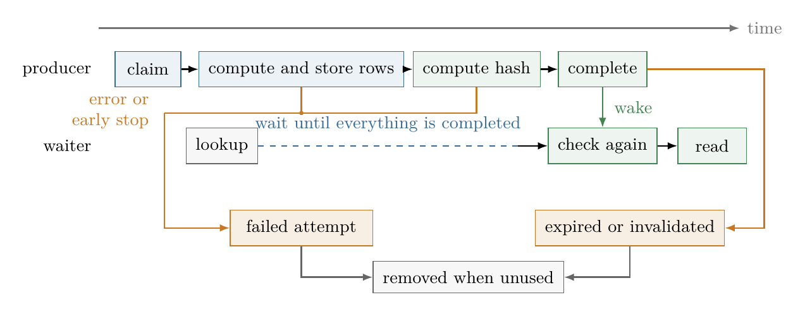
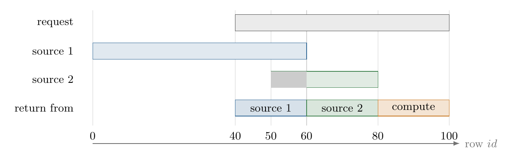

# Caching results

An alignment query may run for hours while returning a small result. If two sessions submit the same request, running the alignment twice wastes work. I created separate small `bioseq_cache` extension that is provided along with BioseqDB.

## Experimental support

This section doesn't go into details of chache implementation, because it's still experimental. I didn't perform enough testing to be confident enough about all edge cases correctness as I needed to be very careful how to lock queries and split work (it needs comparing expression trees to detect query identity or overlap, serializing them to store them, parallel-safe coordination of locking).

The subextension isn't loaded by default and caching is disabled by default. The "exact results" setting is supported now, while "reusable fragments" have most of the code ready except that it was only tested on scalar types (INTs, FLOATs etc.) and sequence support will require some alterations (planner will fallback to "exact results" anyway).

The code checks which data the transaction can see before reusing a result. This still requires more testing to confirm correctness.

## Sharing exact results

The cache subextension coordinates requests and stores completed results. If user executes two identical queries at the same time, we provide special custom scan in plan that waits for currently running job and loads results from it. The scan is added during planning. It checks for a running job during execution and waits until results are available.

*producer* is the query runner that currently executes alignment job. In that timeframe another Postgres-spawned process with other user query waits for results. Submission of partial results would be possible, although very complicated to implement correctly. *sealing* here means that we store the remaining tuples, collect some metadata like tuple counts and compute hashes for the stored result. The cache has expiration TTL time for completed results. With zero TTL, a consumer already waiting for the result can read it once.



Consumer just waits for all results from producer and then reads them.

The consumer sleeps until it is woken and preiodically checks the shared state. If the producer fails or is cancelled I wake all consumers that registered for this job and then each of them will try manually run the query. Their own query can still fail with a SQL error.

The interesting problem is that matching SQL text alone is insufficient. I needed to include analyzed query, parameter values, result types, relevant execution settings, and the database context objects to make sure we reliably detect identical queries. I keep track of query dependencies (all relations) and if the relation changes (row insert), then cache will be invalidated when the change commits. The consumer checks validity again after waiting and runs the query itself if it cannot use the saved result.

## Reusing fragments of queries

The example below describes the generic cache's partial reuse. The current BioseqDB adapter supports exact results only. The generic cache may wait for selected running jobs before computing the missing part.

Suppose that table is kept unchanged, but user slightly changes some metadata condition (for example instead of aligning all sequences with dates between some range, we extend the range to include few more dates). For indentiy comparison I store the analyzed query plan as well so we can say what filter conditions were used for that cache entry.

The general idea of describing what is cached, reading useful part and computing remainer was very loosely inspired by semantic caching paper.[^semantic-cache]

For example, select input rows with $40\leq id<100$. Completed sources cover $0\leq id<60$ and $50\leq id<80$. We read $[40,60)$ from the first source, $[60,80)$ from the second, and compute $[80,100)$.



Example of resuable query with one predicate on the primary ID column. The new request uses source 1 for $[40,60)$, source 2 for $[60,80)$, and computes $[80,100)$. The gray overlap in source 2 is omitted because source 1 already contains those occurrences. Cached rows outside the new request are also omitted.

Let's define it formally via predicates:

- $T(t)$: $t$ is an input tuple
- $A(t,h)$: $h$ is tuple with alignment of tuple $t$
- $p(t)$: the new SQL predicate $P$ evaluates to `TRUE` on $t$
- $c_i(t)$: cached source $i$ covers input tuple $t$, for which the original predicate $P_i$ evaluates to `TRUE`, including inputs that produced no alignment.

Order the selected cached sources from $1$ to $m$, source $i$ supplies part $B_i$, while the reminder we have to compute is $D$:

$$
\begin{aligned}
B_i &= \{(t,h)\mid T(t)\land A(t,h)\land p(t)\land c_i(t)
       \land \forall j<i:\neg c_j(t)\},\\
D &= \{t\mid T(t)\land p(t)\land \forall i\in\{1,\ldots,m\}:\neg c_i(t)\}.
\end{aligned}
$$

Each requested hit is returned from the first valid source covering its input, or computed from $D$:

$$
\{(t,h)\mid T(t)\land A(t,h)\land p(t)\}
= B_1\uplus\cdots\uplus B_m
\uplus\{(t,h)\mid t\in D\land A(t,h)\}.
$$

Here $\uplus$ joins disjoint sets of occurrences. This simple formal description can be implemented as large `UNION ALL` operation of the entries in cache.

With both sources valid, the missing inputs have this equivalent SQL description:

```sql
SELECT id, seq
FROM sequences
WHERE id >= 40 AND id < 100 -- New query we want to compute
  AND (id >=  0 AND id < 60) IS NOT TRUE -- Minus source 1 results
  AND (id >= 50 AND id < 80) IS NOT TRUE; -- Minus source 2 results
```

There are few important details about the implementation:

- **I need to correctly handle NULLs** For a nullable predicate, `NOT P` also becomes unknown when $P$ is unknown. `P IS NOT TRUE` includes both false and unknown, so it keeps every input excluded from the earlier cache.[^postgres-predicates]
- **Handle source failures** If source 1 fails, $c_1$ is false then $D$ should become $[40,50)\cup[80,100)$ so on error we don't abort execution and just adjust computed region (currently this is realised by adding barrier for each query and computing $D$ at the end)
- **Column differences** There could be a case in which source supplies only subset of columns. In this example we assume that the column list is always the same.

[^semantic-cache]: Dar, Franklin, Jónsson, Srivastava, and Tan, [*Semantic Data Caching and Replacement*](https://www.vldb.org/conf/1996/P330.PDF), VLDB 1996, pp. 330-341.
[^postgres-predicates]: PostgreSQL 17, [Comparison Functions and Operators](https://www.postgresql.org/docs/17/functions-comparison.html), Table 9.2.
